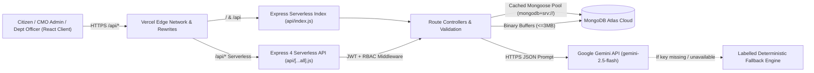

# 02. System Architecture

## 1. High-Level Stack (Backend REST API on Vercel + MongoDB Atlas)
- **Frontend (`../Frontend/`):** Standalone React 18 + Vite web application connecting to `/api/*` locally via Vite proxy or cross-origin via `VITE_API_BASE_URL`.
- **Backend API (`src/` & `api/`):** Node.js 20+ + Express 4 REST API (`src/app.js`) wrapped for Vercel Serverless Functions via entry points (`api/index.js` and `api/[...all].js`).
- **Database (`MongoDB Atlas`):** Mongoose ODM using `mongodb+srv://` Atlas URI with a cached global connection promise (`global._mongooseCache`) and `bufferCommands: false` to prevent cold-start connection leaks or buffering timeouts on Vercel.
- **File Handling:** Multer `memoryStorage()` validates MIME types and size (`<= 3 MB`, safely under Vercel's 4.5 MB request body ceiling) and stores file buffers directly in MongoDB Atlas `Attachment` documents (`GET /api/attachments/:id`), avoiding ephemeral serverless disk issues.
- **AI Layer:** Google Gemini REST API (`gemini-2.5-flash` with `gemini-2.0-flash` fallback) generating structured JSON output (`optimizedSubject`, `optimizedDescription`, `summary`, `highlights`, `suggestedDepartmentCode`, `suggestedCategory`, `suggestedPriority`, `duplicateMatches`), backed by a clearly labelled deterministic heuristic fallback (`isFallback: true`).

## 2. System Architecture Diagram

## 3. Request Lifecycle & Security Layers
1. **Security Headers & CORS:** `helmet` (with `crossOriginResourcePolicy: false` for attachment previews) and configurable `CORS_ORIGIN`.
2. **Rate Limiting:** `express-rate-limit` protecting `/api/auth/*` and `/api/ai/*` with `trust proxy = 1` for Vercel proxy headers.
3. **Database Cold-Start Readiness:** `dbMiddleware` awaits `ensureDatabaseReady()` before controller execution, connecting cleanly to Atlas and optionally performing idempotent demo seeding (`AUTO_SEED_DEMO=true`).
4. **Authentication & RBAC:** Bearer JWT verification (`authenticate`) and role guards (`authorizeRoles('citizen' | 'cmo_admin' | 'department_officer')`) enforce strict data boundaries on every protected endpoint.
5. **Global Error Handling:** Centralized error middleware normalizes Mongoose validation/cast/duplicate errors, Multer payload limits, and `AppError` responses into consistent JSON.
