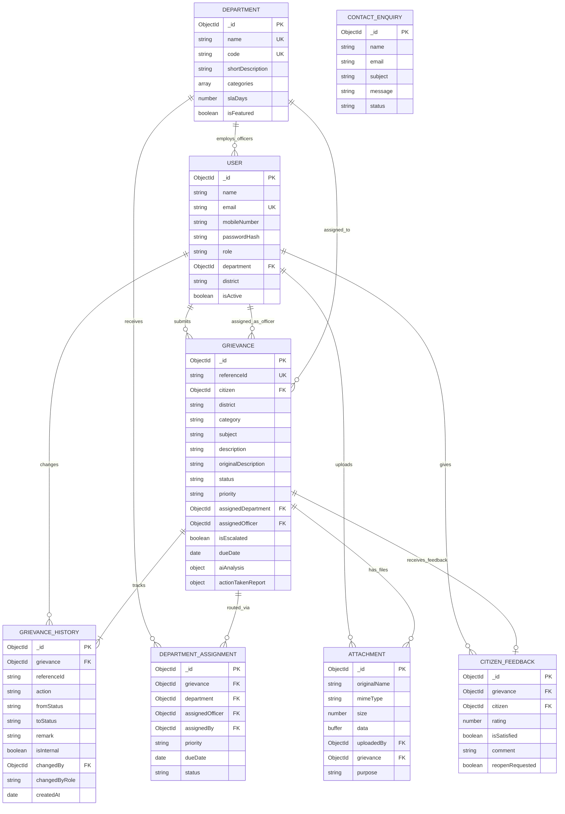

# 03. Database Design (MongoDB Atlas + Mongoose)

## 1. MongoDB Atlas Serverless Design Principles
- **Cloud-Native Atlas URI (`mongodb+srv://`):** Configured strictly for MongoDB Atlas (not local MongoDB Compass).
- **Connection Pooling Reuse:** `src/config/db.js` caches the Mongoose connection promise on `global._mongooseCache` so Vercel serverless warm invocations reuse connections rather than exhausting Atlas M0 connection limits.
- **Fast Failover:** `mongoose.set('bufferCommands', false)` ensures disconnected states fail fast with HTTP 503 rather than stalling until serverless timeout.
- **Serverless Attachment Storage:** Binary attachments (`<= 3 MB`) are stored in the `attachments` collection (`data: Buffer` with `select: false`) so list queries remain lightweight while uploaded evidence and action reports persist reliably across Vercel stateless containers.

## 2. Database Entity-Relationship (ER) Diagram

## 3. Collection Specifications

1. **`users` (`User`)**
   - Supports three roles via `role`: `citizen`, `cmo_admin`, `department_officer`.
   - `passwordHash` (`select: false`) hashed via `bcryptjs`.
   - `department` links department officers to their `Department`.
2. **`departments` (`Department`)**
   - Holds sample government departments (`PWD`, `HLTH`, `EDU`, `WTR`, `PWR`, `REV`, `TRN`, `WEL`) with `slaDays`, `categories`, and descriptions.
3. **`grievances` (`Grievance`)**
   - Unique human-readable `referenceId` (`KL-CMO-YYYY-XXXXXX`).
   - Enforces the 14 Kerala districts enum, category enum, status enum (`Submitted`, `Under Review`, `In Progress`, `Resolved`, `Reopened`), and priority enum (`Low`, `Medium`, `High`).
   - Stores `originalDescription` alongside AI-accepted `description`, embedded `aiAnalysis` advisory snapshot, `cmoPublicRemark`, `cmoInternalRemarks`, `officerRemarks`, `actionTakenReport`, `dueDate`, and `isEscalated`.
   - Indexed on `referenceId`, `citizen`, `status`, `district`, `category`, `priority`, `assignedDepartment`, `dueDate`, `createdAt`, plus a text index on `subject` & `description`.
4. **`grievancehistories` (`GrievanceHistory`)**
   - Immutable audit log recording every status transition with `fromStatus`, `toStatus`, `action`, `remark`, `isInternal`, `changedBy`, `changedByRole`, `changedByName`, and `createdAt`.
5. **`departmentassignments` (`DepartmentAssignment`)**
   - Tracks formal CMO-to-department/officer handoffs with instructions, SLA `dueDate`, and assignment lifecycle (`Assigned`, `In Progress`, `Action Submitted`, `Completed`, `Reassigned`).
6. **`attachments` (`Attachment`)**
   - Stores `originalName`, `mimeType`, `size`, `purpose` (`citizen_evidence` | `action_report`), `uploadedBy`, `grievance`, and `data` (`Buffer`, `select: false`).
7. **`citizenfeedbacks` (`CitizenFeedback`)**
   - One-to-one feedback record per resolved grievance (`rating` 1–5, `isSatisfied`, `comment`, `reopenRequested`).
8. **`contactenquiries` (`ContactEnquiry`)**
   - Persists public Contact Us form submissions (`name`, `email`, `subject`, `message`, `status`).
